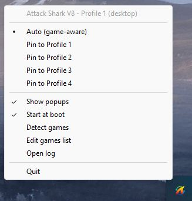
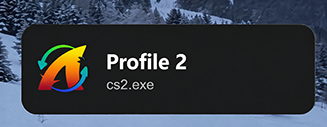

# Attack Shark V8 — automatic profile switcher

> **Attack Shark X6 (versao modificada):** tambem funciona com o X6, pelo
> receptor 2.4G ou pelo cabo. Clique no icone da bandeja (ou botao direito >
> **Settings**) para abrir a tela de configuracoes, com as abas **Perfis**
> (criar, editar e testar perfis no mouse antes de salvar, e escolher qual
> usar fora e dentro dos jogos), **Jogos** (lista de jogos e deteccao
> automatica na Steam/Epic) e **Logs** (atividade ao vivo). Ao salvar, o
> switcher aplica sozinho, sem reiniciar. Tambem abre com
> `python profiles_editor.py`.
> O X6 nao guarda perfis no mouse, entao os
> perfis dele ficam no `config.json`, na secao `"x6"`: DPI, `polling`
> (125/250/500/1000), `key_response_ms` (par, 2 a 20), `deep_sleep_min`
> (1 a 15), `ripple` e `angle_snap` (true/false). `dpi_stages` sao os 6
> estagios do botao de DPI. Perfil 1 = desktop, perfil 2 = jogo (ou o que
> estiver em `default_profile` / `game_profile`). Nao precisa configurar
> nada no app da Attack Shark.

For Attack Shark mice, tested and working on the Attack Shark V8.

The Attack Shark V8 mouse have several onboard profiles (DPI, polling rate, 
button mapping), but switching between them is only allowed manually via 
the Attack Shark Mouse Hub software. This tool switches automatically: 
it automatically detects when you launch a game and switch to your gaming
profile (e.g. 8KHz polling), and flips it back to your desktop profile (e.g.
125Hz, for battery life) when you quit.

It talks to the mouse directly over its USB receiver. The Attack Shark Hub 
software is only needed to set up what each profile contains, it is not 
necessary when this tool is running although they can both be used at 
the same time.

## Requirements

- Windows 10 or 11
- Python **3.9+, 64-bit**, including **tkinter** (ticked by default in the
  python.org installer as "tcl/tk and IDLE")
- An Attack Shark V8 with its 8K wireless dongle

## Install

Double-click **`install.bat`**. It installs everything needed, sets the app
to start automatically when you log in, adds a shortcut to your desktop and
Start Menu, and launches it.

## Setup

1. In the ATTACK SHARK MOUSE HUB, configure Profile 1 (desktop) and Profile 2
   (gaming) the way you want them — DPI, polling rate, button mapping.
2. Add your games from the tray menu's **Detect games** — it scans your
   installed Steam and Epic library and fills in `config.json` for you.
   **Double-check the result**: the guess is a heuristic and can occasionally
   pick the wrong `.exe`. Add anything it missed by hand.
3. Launch a game and confirm the popup overlay appears at the bottom right
   corner of the screen

## How to use

A tray icon shows the active profile:



- **Auto (game-aware)** — the normal mode.
- **Pin to Profile 1–4** — hold one profile and suspend automatic switching.
- **Show popups** — mute or unmute the popup overlay for this session.
- **Start at boot** — check or uncheck to control whether it launches at login.
- **Detect games** — rescan for installed games and add any new ones.
- **Edit games list** — opens `config.json`.
- **Open log** — for troubleshooting.
- **Quit** — also puts the mouse back on your desktop profile.

## The popup overlay

When a game starts or exits, a small card appears briefly in the corner of
your screen, naming the new profile and the game (or "Desktop"):



It only appears on an actual game transition — entering or leaving a game.

## config.json

```json
{
  "default_profile": 1,
  "game_profile": 2,
  "poll_seconds": 2,
  "popup_enabled": true,
  "popup_duration_ms": 10000,
  "games": ["cs2.exe"]
}
```

`games` are executable names, matched case-insensitively — no paths. To find
a game's executable, launch it and look in Task Manager → Details.

Save the file as UTF-8.

## Notes

- Tested and working on Attack Shark V8 with Mouse Firmware version V3.03,
  Receiver firmware version v3.00 and Attack Shark Mouse Hub V1.0.2.0.

## Start at boot

Toggle this any time from the tray menu's Start at boot checkbox. 

## Command line

For scripting or troubleshooting:

```bash
python sharkctl.py 3          # switch to Profile 3
python sharkctl.py get        # read the active profile
python switcher.py --dry-run  # log decisions without touching the mouse
python switcher.py --no-tray  # run headless (popups still shown)
```
